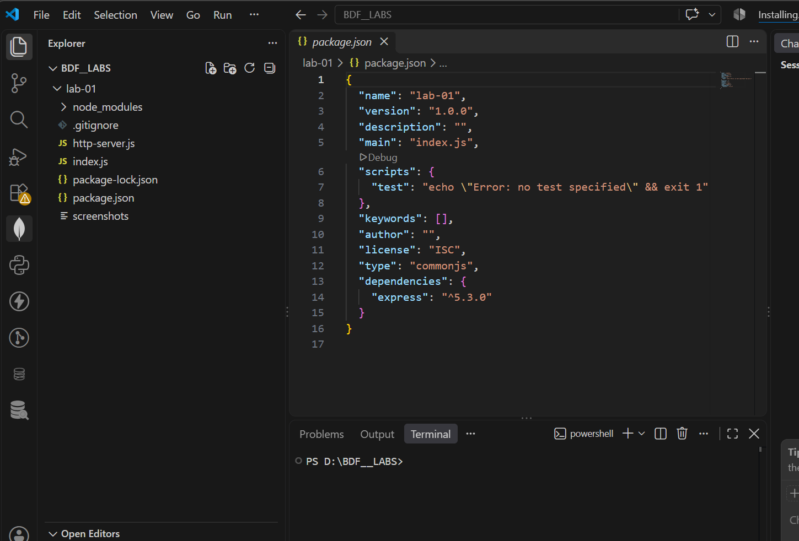
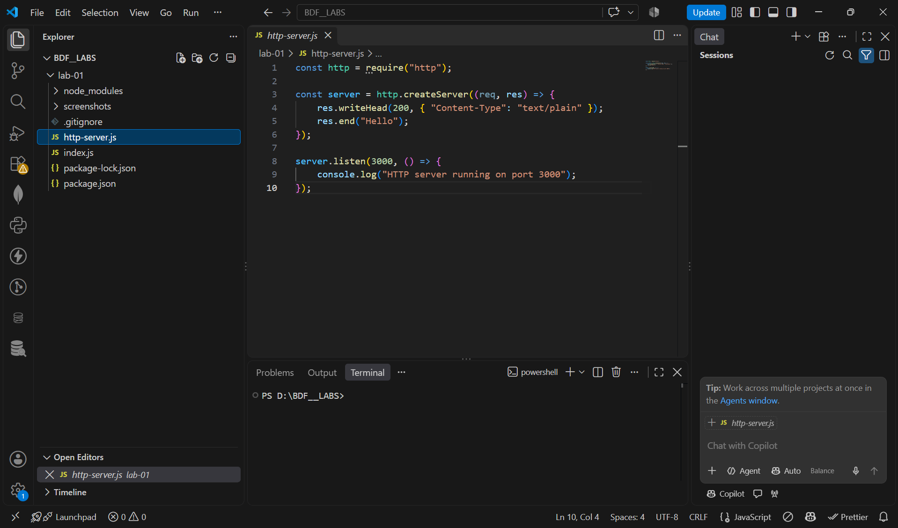
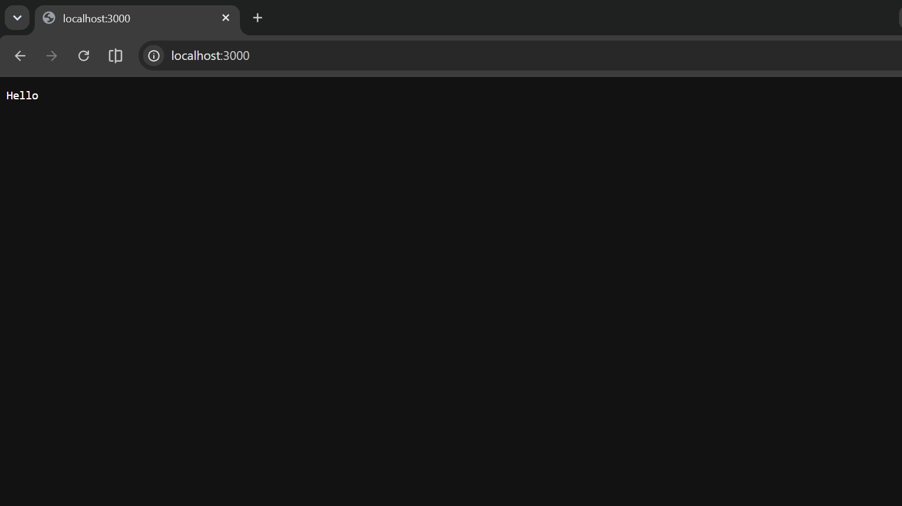
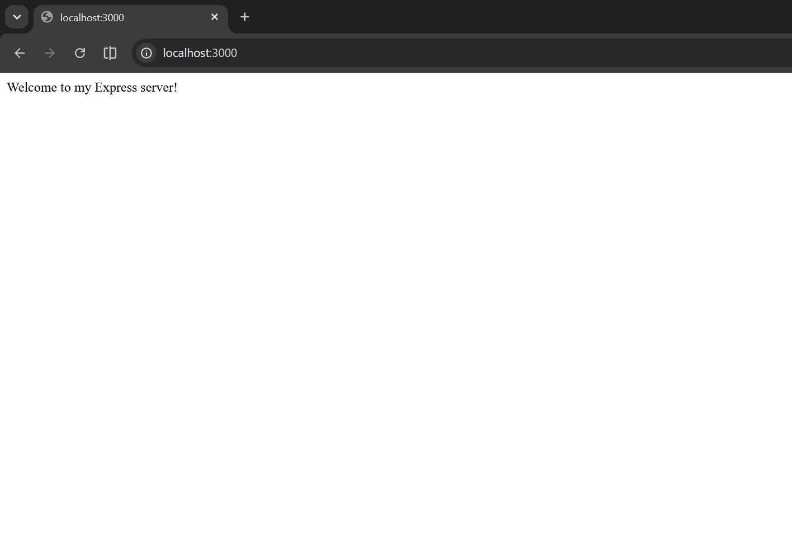
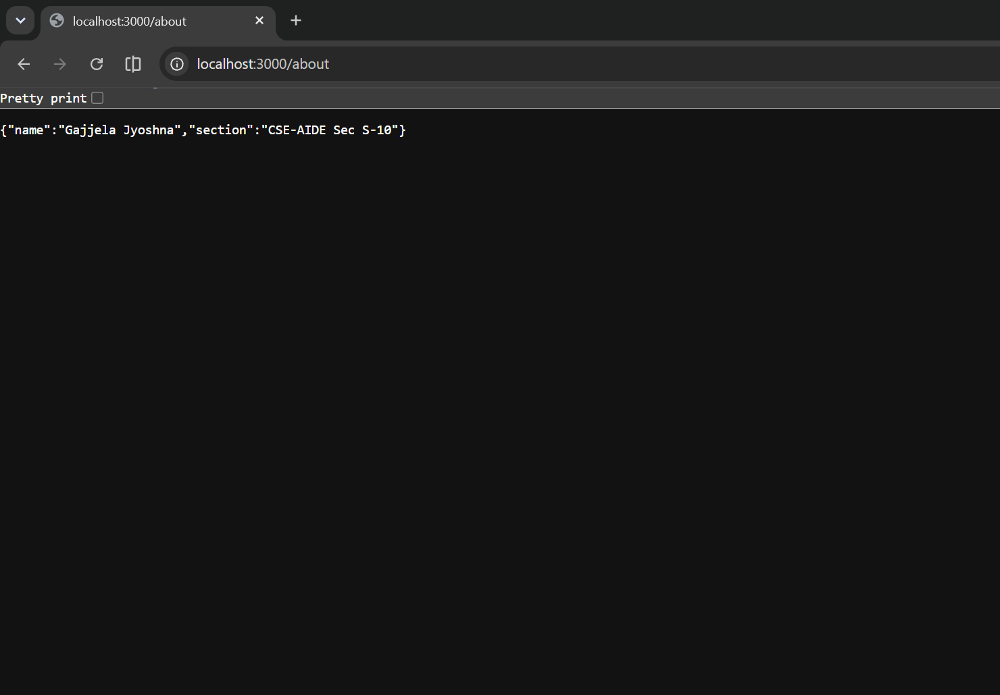
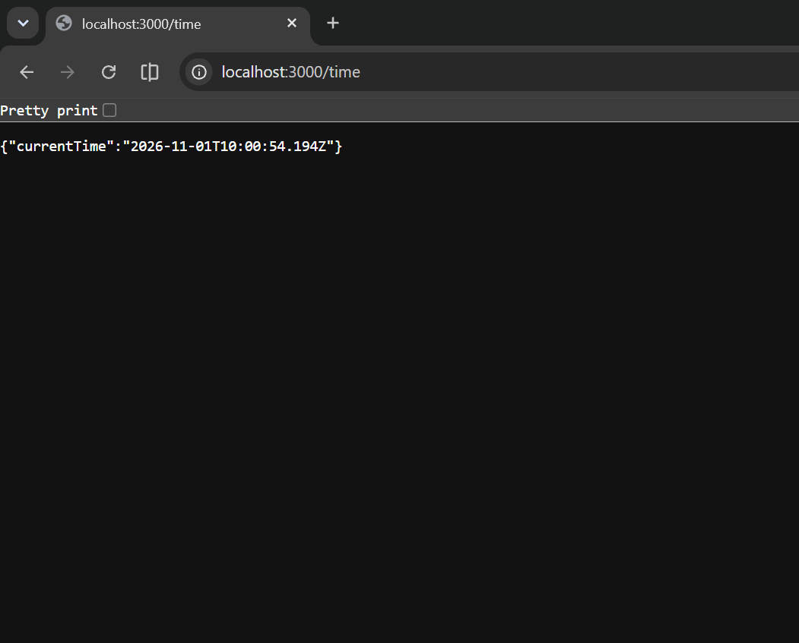
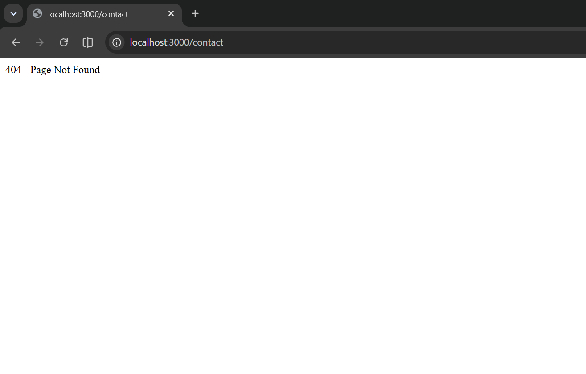

# Lab 1: Node.js and Express Server

## 1. Objective

To set up a Node.js project and create a basic web server using Node.js built-in HTTP module and Express.js. Implement different routes and handle invalid routes using a 404 response.

## 2. Technologies Used

* Node.js
* Express.js
* JavaScript
* Visual Studio Code
* Google Chrome

## 3. Project Setup

1. Created a project folder named `lab-01`.

2. Initialised the Node.js project using:

   ```bash
   npm init -y
   ```

3. Installed Express using:

   ```bash
   npm install express
   ```

## 4. Implementation

### Part A: Node.js HTTP Server

Created `http-server.js` using Node.js built-in HTTP module.

To run:

```bash
node http-server.js
```

The server runs on port 3000 and displays the message `Hello`.

### Part B: Express Server

Created `index.js` using Express.js.

To run:

```bash
node index.js
```

The Express server implements the following routes:

| Route      | Description                    | Expected Output               | Status |
| ---------- | ------------------------------ | ----------------------------- | ------ |
| `/`        | Home page                      | Welcome to my Express server! | 200    |
| `/about`   | Displays name and section      | JSON response                 | 200    |
| `/time`    | Displays current date and time | JSON response                 | 200    |
| `/contact` | Handles an unknown route       | 404 - Page Not Found          | 404    |

## 5. Screenshots

### Project Structure



### HTTP Server Code



### HTTP Server Output



### Express Home Route



### Express About Route



### Express Time Route



### Express 404 Route



## 6. Result

Successfully created and executed a basic HTTP server using Node.js and an Express server with multiple routes. Tested the endpoints in Google Chrome and verified the appropriate HTTP status codes, including the 404 response for an unknown route.

## 7. Conclusion

This lab helped me understand how to initialise a Node.js project, install Express.js, create a web server, define routes, handle HTTP requests and responses, and manage invalid routes using a 404 status code.
