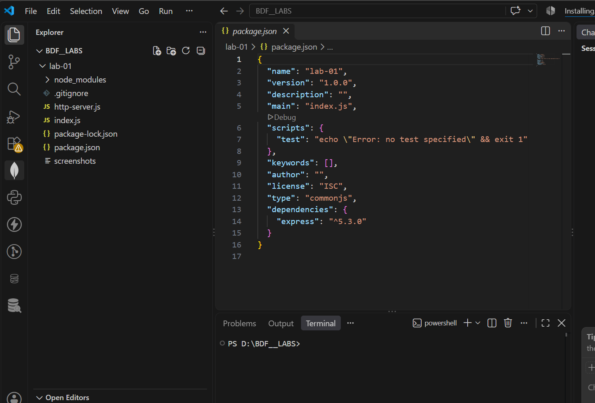
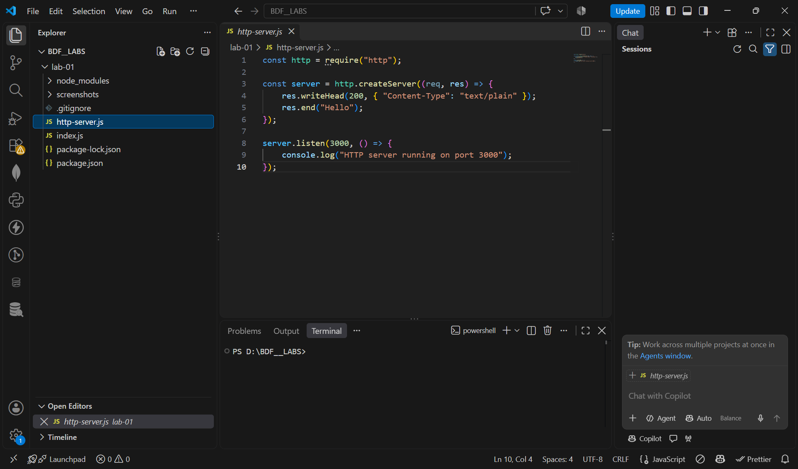
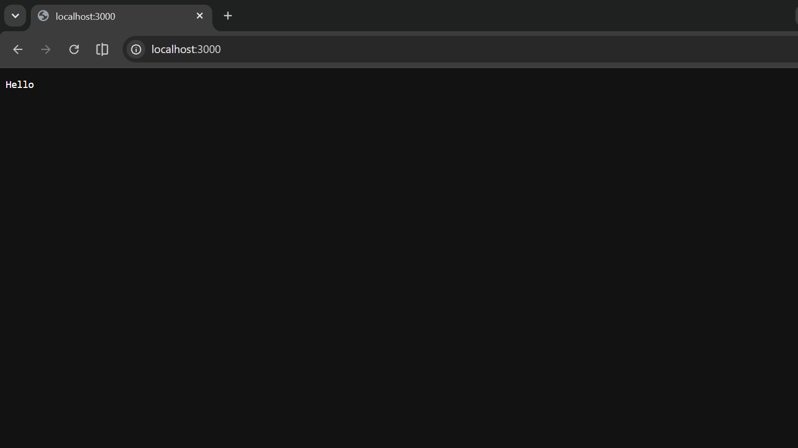
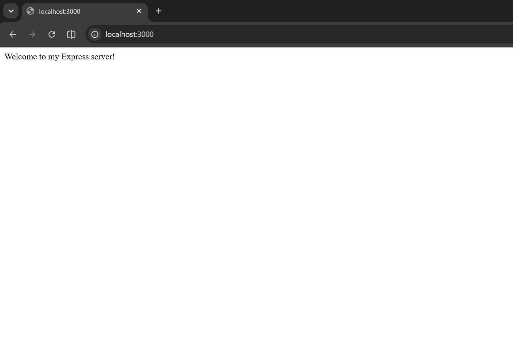
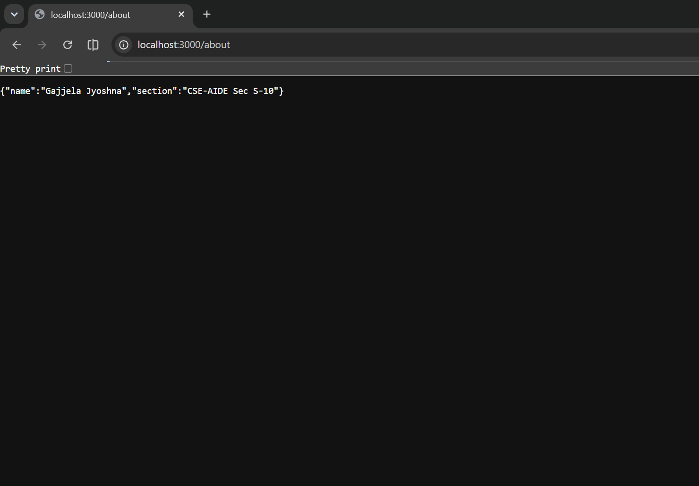
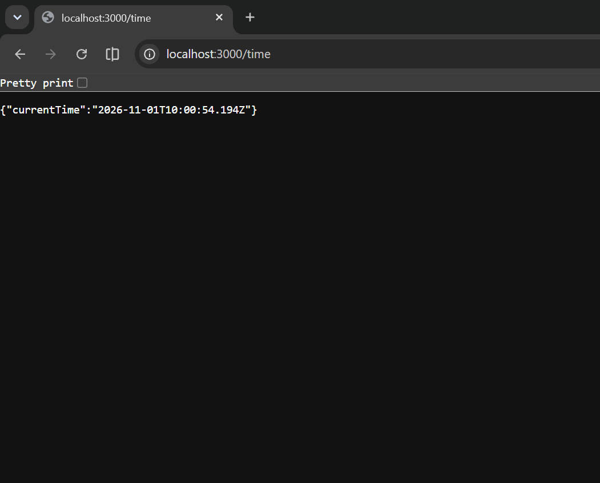
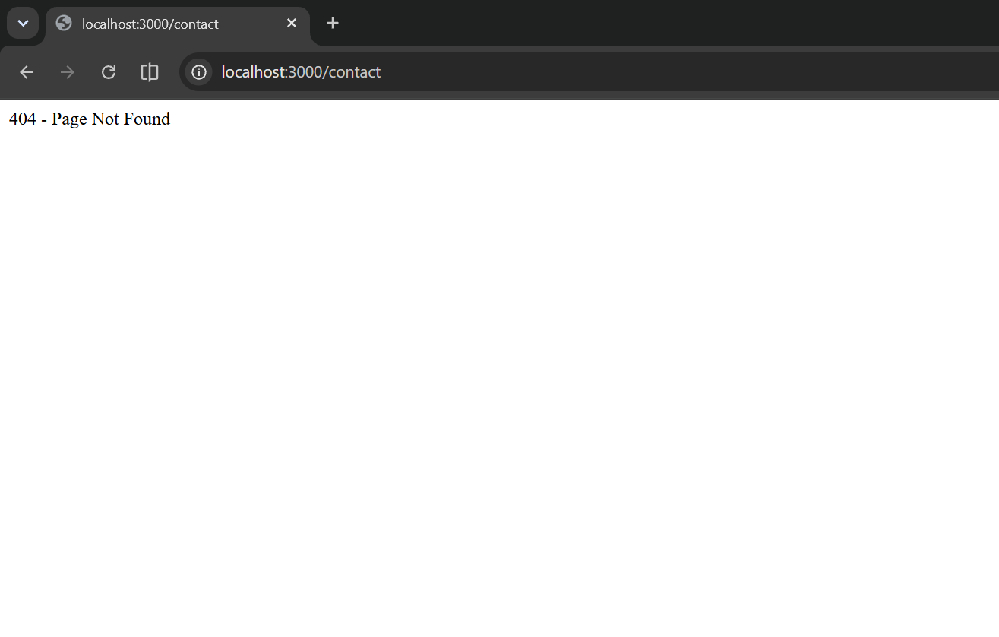
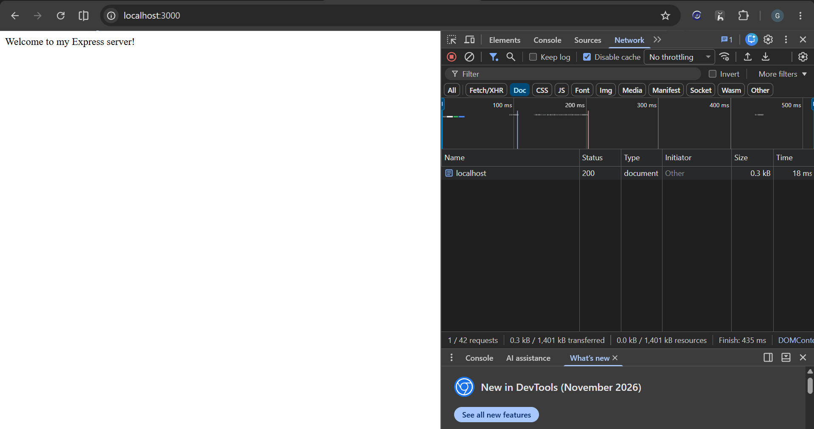

# Lab 1: Node.js and Express Server

**Course:** Backend Development Fundamentals
**Year:** II
**Term:** II
**Student Name:** Gajjela Jyoshna
**Registration Number:** 252U1R5045
**Section:** CSE-AIDE Sec S-10


## Live Deployment

**Platform:** Render
**Live URL:** https://bdf-lab-01-eoso.onrender.com/

## Objective

To set up a Node.js project and build a small web server using the built-in HTTP module and Express.js. This lab demonstrates how to create a server, handle different GET requests, return JSON responses and manage unknown routes.

## Project Structure

```text
lab-01/
│
├── http-server.js
├── index.js
├── package.json
├── package-lock.json
├── .gitignore
├── README.md
│
└── screenshots/
    ├── project-setup.png
    ├── http-server-code.png
    ├── http-server-output.png
    ├── express-home.png
    ├── express-about.png
    ├── express-time.png
    ├── express-404.png
    ├── network-200.png
    └── network-400.png
```

## 1. How to Run the Project

### Prerequisites

* Node.js installed
* npm (Node Package Manager)
* A code editor such as Visual Studio Code

### Installation

1. Open the project folder in the terminal.
2. Install the required dependencies:

```bash
npm install
```

3. Start the Express server:

```bash
node index.js
```

4. Open the browser and visit:

```text
http://localhost:3000
```

### Environment Variables

 Variable  Description                     Default Value
 
 PORT      Port number used by the server  3000          

The application uses `process.env.PORT || 3000`. No `.env` file is required for this lab.

### package.json Explanation

 Field         Description                                             

 name          Name of the Node.js project                             
 version       Current project version                                 
 main          Main entry point specified in the package configuration 
 scripts       Commands used to run project tasks                      
 dependencies  External packages required by the project               

Express.js is listed under dependencies. The `node_modules` folder contains the installed packages and is excluded from GitHub using `.gitignore`.

## 2. Implementation

### A. Node.js HTTP Server

Created a basic HTTP server using Node.js's built-in `http` module. It responds with the text **Hello** and listens on port 3000.

### B. Express Server

Created an Express application using `express()` and configured the following routes:

* GET `/` – Displays a welcome message.
* GET `/about` – Returns student information in JSON format.
* GET `/time` – Returns the current date and time using `new Date()`.
* Unknown routes – Return a 404 Page Not Found response.

## 3. Endpoints

 HTTP Method  Endpoint    Description                                   Status Code 

 GET          `/`         Displays the welcome message                    200         
 GET          `/about`   Returns name and section in JSON format         200         
 GET        `/time`    Returns current date and time in JSON format      200         
 GET          `/contact` Returns Page Not Found for an unknown route  404         

## 4. Screenshots

### Project Setup



### Node.js HTTP Server Code



### HTTP Server Output



### Express Home Route



### Express About Route



### Express Time Route



### Express 404 Response



### Successful HTTP Response



### HTTP Error Response


## 5. Notes: Problems Faced and Solutions

1. **Express dependency:** Installed Express.js using `npm install express` to use the Express framework.
2. **Server port configuration:** Used `process.env.PORT || 3000` so that the application can run locally and on Render.
3. **Deployment configuration:** Configured the correct project root directory and start command in Render to deploy the application successfully.

## 6. Result

Successfully created and tested a Node.js HTTP server and an Express.js server with the required routes. Verified successful responses and the 404 response. The Express application was also deployed successfully using Render.

## GitHub Repository

https://github.com/jyoshnagajjela/backend-development-fundamentals
